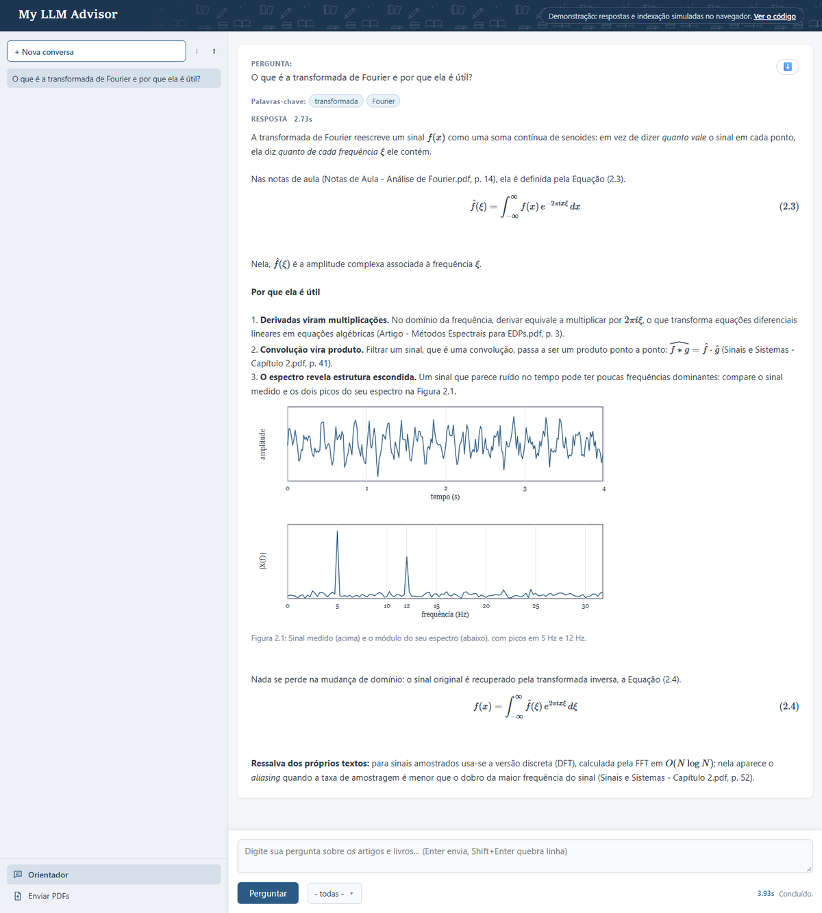

# My LLM Advisor — seu orientador científico pessoal

Converse com os seus artigos científicos e livros. Envie os PDFs e o My LLM
Advisor os indexa — texto, figuras e equações, convertidas para LaTeX — e
responde às perguntas citando o documento e a página, com as equações
renderizadas e as figuras no meio da resposta. Tudo roda localmente, com
modelos do [Ollama](https://ollama.com/): nenhuma API paga, e nenhum
documento sai da sua máquina.

**[Ver a demonstração](https://feanored.github.io/MyLLMAdvisor/)** — as telas
reais, com respostas e indexação simuladas no navegador.

[](https://feanored.github.io/MyLLMAdvisor/)

## Recursos

- **Orientador** — chat sobre os documentos da base, com memória da conversa,
  filtro por documento e citação de arquivo e página. Conversas salvas no
  navegador, com exportação e importação em CSV.
- **Equações em LaTeX** — cada fórmula do PDF é transcrita para LaTeX pelo
  GLM-OCR e renderizada pelo MathJax; quando a resposta cita "Equação (3.2)",
  a equação indexada aparece logo em seguida.
- **Figuras** — extraídas dos PDFs e descritas por um modelo de visão, entram
  na busca e aparecem na resposta quando citadas.
- **Enviar PDFs** — upload pelo navegador, com a indexação de cada arquivo
  acompanhada etapa por etapa, e exclusão de um PDF da base (para reindexá-lo)
  com confirmação.
- **Busca por palavras-chave e frase inteira** juntas, para o contexto não ser
  dominado por um termo genérico da pergunta.
- **Responsivo** — no celular, o menu lateral vira um trilho de ícones.

## Início rápido

Requisitos: Python 3.14 e o [Ollama](https://ollama.com/) rodando.

```powershell
python -m venv .venv
.\.venv\Scripts\Activate.ps1          # Linux/macOS: source .venv/bin/activate
pip install flask chromadb ollama numpy docling

ollama pull bge-m3       # embedding
ollama pull qwen3:14b    # chat
ollama pull qwen3.5      # descrição das figuras
ollama pull glm-ocr      # equações -> LaTeX
```

Em dois terminais, com o ambiente ativado:

```bash
chroma run --path ./.chromadb --port 8000   # banco vetorial (deixe rodando)
python rag_web.py                            # abre em http://localhost:5001
```

Abra **Enviar PDFs** no menu lateral, envie seus PDFs e, quando a indexação
terminar, pergunte no **Orientador**. Para indexar uma pasta inteira pela
linha de comando, com o servidor do Chroma parado:
`python rag_papers.py index <pasta_com_pdfs>`.

## Estrutura

| Caminho | O que é |
|---|---|
| `rag_web.py` | servidor web Flask (rotas) |
| `rag_papers.py` | indexação dos PDFs: Docling, OCR das fórmulas, descrição das figuras |
| `services/`, `factories/`, `models/` | regras de negócio, criação dos clients e configuração (`models/config.py`) |
| `templates/`, `static/` | telas (layout comum em `templates/base.html`) e front-end em módulos ES |
| `demo/` | demonstração estática para o GitHub Pages |

## Documentação

A documentação completa está em [doc/documentation.md](doc/documentation.md). Atalhos:

- [Arquitetura](doc/documentation.md#organização-interna-de-rag_webpy-mvc--factory--service) e [layout comum das telas](doc/documentation.md#layout-comum-das-telas) (como criar uma tela nova)
- [Requisitos e modelos do Ollama](doc/documentation.md#requisitos)
- [Subindo o ambiente](doc/documentation.md#subindo-o-ambiente) (e por que não indexar pela linha de comando com o Chroma no ar)
- [Equações em LaTeX](doc/documentation.md#equações-em-latex)
- [Orientador](doc/documentation.md#--orientador): prompt, memória da conversa, figuras e equações na resposta
- [Enviar PDFs](doc/documentation.md#upload--enviar-pdfs)
- [Busca por palavras-chave](doc/documentation.md#busca-por-palavras-chave)
- [Endpoints](doc/documentation.md#endpoints)
- [Demonstração no GitHub Pages](doc/documentation.md#demonstração-no-github-pages)

## Licença

[AGPL-3.0](LICENSE).
